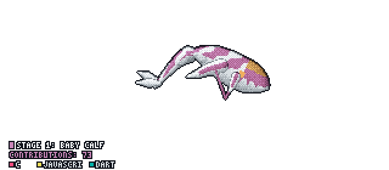

# 👋 Hi, I'm Uday Kumar

### Software Developer · Problem Solver · AI/ML Enthusiast

I enjoy turning ideas into working software, solving challenging problems, and exploring intelligent systems.

- 🔭 Building full-stack applications and exploring AI-powered solutions.
- 🧠 Practising Data Structures & Algorithms and competitive programming.
- 💻 Interested in backend engineering, system design, and machine learning.
- 🌱 Always learning, experimenting, and building.

---

### ⚡ Tech Stack

**Languages**

**Frontend & Mobile**

**Backend & Databases**

**AI / ML & Tools**

---

### 🚀 Featured Projects

| Project | Description | Tech Stack |
|:---|:---|:---|
| **Campus Lost & Found** | A platform to report, discover and recover lost campus belongings. | Next.js, PostgreSQL, pgvector |
| **LVLYN** | A gamified productivity and task management application. | Next.js, Tailwind CSS |
| **OCEO** | A social safety platform focused on coastal communities. | Flutter, Firebase |
| **AI Avatar** | An AI-powered conversational avatar with speech and lip synchronization. | Next.js, FastAPI, Gemini |

---

---

### 🎏 Contribution Activity

  

---

### 🤝 Let's Connect

  
  

---

  <i>"Great software is built one thoughtful solution at a time."</i>

